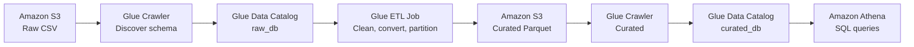

# AWS Data Engineering Starter Project: CSV to Parquet with S3, Glue and Athena

A beginner-friendly, hands-on project that builds a serverless data pipeline on AWS. Raw CSV files are cleaned, converted to partitioned Parquet, and queried with SQL, all without managing a single EC2 server.


---

## Table of contents

1. [What you will build](#1-what-you-will-build)
2. [Architecture](#2-architecture)
3. [Project structure](#3-project-structure)
4. [Prerequisites](#4-prerequisites)
5. [Create your AWS resources](#5-create-your-aws-resources)
6. [Configure AWS Glue](#6-configure-aws-glue)
7. [Build the ETL job](#7-build-the-etl-job)
8. [Make the data queryable in Athena](#8-make-the-data-queryable-in-athena)
9. [Automate the pipeline](#9-automate-the-pipeline)
10. [Monitoring, cost and production checks](#10-monitoring-cost-and-production-checks)
11. [Go-live checklist](#11-go-live-checklist)
12. [Clean up](#12-clean-up)
13. [Author](#13-author)

---

## 1. What you will build

A batch pipeline that:

- Stores raw CSV order data in **Amazon S3**
- Discovers the schema automatically with an **AWS Glue Crawler**
- Cleans, converts and partitions the data with an **AWS Glue ETL job** (PySpark)
- Writes optimized **Parquet** files to a curated S3 location, partitioned by year and month
- Makes the result queryable with standard SQL in **Amazon Athena**

**Skills practiced:** S3 data lake layout, IAM roles, Glue Data Catalog, Glue crawlers, PySpark ETL, partitioning, Athena SQL, basic orchestration and cost awareness.

---

## 2. Architecture



| Component | Role |
| --- | --- |
| Amazon S3 (raw) | Holds the original CSV file |
| AWS Glue Crawler | Discovers the CSV schema and creates table metadata |
| AWS Glue ETL job | Cleans, converts and partitions the data |
| Amazon S3 (curated) | Stores optimized Parquet files by year and month |
| Glue Data Catalog + Athena | Describes the output table and lets you query it with SQL |

> The Glue Data Catalog stores only the **metadata** that describes your tables. The actual data always stays in S3. Athena uses the catalog to query that data.

References: [Glue crawler tutorial](https://docs.aws.amazon.com/glue/latest/dg/tutorial-add-crawler.html) | [Athena and the Glue Data Catalog](https://docs.aws.amazon.com/athena/latest/ug/data-sources-glue.html)

---

## 3. Project structure

```
aws-csv-to-parquet-starter/
├── README.md
├── data/
│   └── orders.csv              # Sample dataset
└── scripts/
    └── csv_to_parquet.py       # Glue ETL script (PySpark)
```

---

## 4. Prerequisites

- An AWS account with permission to use S3, IAM, Glue and Athena
- Basic familiarity with the AWS Management Console
- A single AWS Region used for **all** services (for example `us-east-1`)

---

## 5. Create your AWS resources

### Step 1: Choose your AWS Region

Sign in to the AWS Management Console and choose one Region, such as `us-east-1` (US East, N. Virginia).

Use the **same Region** for S3, AWS Glue and Athena throughout this project.

### Step 2: Create an S3 bucket

1. Open the Amazon S3 console and select **Create bucket**.
2. Choose a globally unique name, for example: `raw-parquet-demo-youruniqueid`
3. Keep **Block all public access** enabled and **default encryption** enabled.
4. Inside the bucket, create these prefixes:

| Prefix | Purpose |
| --- | --- |
| `raw/orders/` | Original CSV files |
| `curated/orders/` | Transformed Parquet data |
| `scripts/` | Glue ETL Python script |
| `temp/` | Temporary files used by Glue |
| `athena-results/` | Athena query results |

Replace `youruniqueid` with your own unique value. **Do not make the bucket public.**

### Step 3: Prepare your sample CSV

The sample file is `orders.csv`. It contains these columns:

```csv
order_id,customer_id,order_date,amount,status
1001,C001,2026-10-01,125.50,PAID
1002,C002,2026-10-02,80.00,NEW
1003,C001,2026-10-03,220.75,PAID
1004,C003,2026-10-04,45.25,CANCELLED
1005,C002,2026-10-05,99.99,PAID
```

Upload `data/orders.csv` to:

```
s3://YOUR_BUCKET/raw/orders/orders.csv
```

Replace `YOUR_BUCKET` with your actual bucket name. You can use your own dataset later, but the provided ETL script expects the five column names shown above.

### Step 4: Create the AWS Glue IAM role

Glue needs permission to read from S3, write the transformed files and access the Data Catalog.

1. Open **IAM → Roles → Create role**.
2. Select **AWS Glue** as the trusted service.
3. Attach the `AWSGlueServiceRole` managed policy and add a custom S3 policy limited to your bucket.

The required access is approximately:

| Resource | Required access |
| --- | --- |
| `raw/` | List and read objects |
| `scripts/` | Read the ETL script |
| `curated/` | Read, write and delete objects as needed for the demo's overwrite mode |
| `temp/` | Read and write temporary objects |
| Glue Data Catalog | Read table metadata and update crawler metadata |
| CloudWatch Logs | Write job logs |

> For production, use separate, more restrictive roles for the crawler and the ETL job instead of sharing broad permissions. See [Configuring IAM permissions for Glue](https://docs.aws.amazon.com/glue/latest/dg/configure-iam-for-glue.html).

---

## 6. Configure AWS Glue

### Step 5: Create the raw Data Catalog database

Open **AWS Glue → Data Catalog → Databases**, select **Create database** and enter:

```
raw_db
```

This database holds the metadata for the raw CSV table.

### Step 6: Create the raw CSV crawler

Open **AWS Glue → Crawlers → Create crawler** and configure:

| Setting | Value |
| --- | --- |
| Crawler name | `orders-raw-crawler` |
| Data source | Amazon S3 |
| S3 path | `s3://YOUR_BUCKET/raw/orders/` |
| IAM role | Your Glue IAM role |
| Target database | `raw_db` |
| Schedule | On demand |

Create the crawler, select it and click **Run**.

When it finishes, open **Data Catalog → Tables** and look for the `orders` table in `raw_db`. Verify that Glue detected the CSV columns. If the table name or column names differ from the sample, use the actual names in the ETL configuration.

> The crawler only discovers the schema and creates catalog metadata. It does **not** transform the CSV. See the [AWS crawler guide](https://docs.aws.amazon.com/glue/latest/dg/tutorial-add-crawler.html).

---

## 7. Build the ETL job

### Step 7: Upload the Glue Python script

Upload `scripts/csv_to_parquet.py` to:

```
s3://YOUR_BUCKET/scripts/csv_to_parquet.py
```

The script performs four main operations:

1. Reads the raw table using the Glue Data Catalog.
2. Trims text, converts the date and amount fields, and removes rows without valid order IDs or dates.
3. Adds `order_year` and `order_month` partition columns.
4. Writes the result as Parquet to the curated S3 location.

It also deduplicates by `order_id`, assuming that ID uniquely identifies an order. Remove or change that rule if it is not valid for your real dataset.

### Step 8: Create the Glue ETL job

Open **AWS Glue → ETL jobs** and create a **Spark/Python** job with these settings:

| Setting | Value |
| --- | --- |
| Job name | `csv-to-parquet-etl` |
| IAM role | Your Glue IAM role |
| Script location | `s3://YOUR_BUCKET/scripts/csv_to_parquet.py` |
| Temporary path | `s3://YOUR_BUCKET/temp/` |
| Glue version | A currently available supported version |
| Worker configuration | Start with a small configuration suitable for your test |

Add these job parameters (in the console, parameter keys begin with `--`):

| Parameter key | Value |
| --- | --- |
| `--SOURCE_DATABASE` | `raw_db` |
| `--SOURCE_TABLE` | `orders` |
| `--TARGET_PATH` | `s3://YOUR_BUCKET/curated/orders/` |

Save the job and choose **Run**.

Reference: [Configuring job properties for Spark jobs](https://docs.aws.amazon.com/glue/latest/dg/add-job.html)

### Step 9: Verify the Parquet output

Once the job succeeds, open your S3 bucket and browse to `curated/orders/`. You should see paths similar to:

```
curated/
└── orders/
    └── order_year=2026/
        └── order_month=10/
            └── part-....parquet
```

This is the key result of the project: raw CSV records transformed into **partitioned Parquet files**.

Partitioning lets Athena skip irrelevant partitions when a query filters by the partition keys. See [Managing partitions for ETL output](https://docs.aws.amazon.com/glue/latest/dg/aws-glue-programming-etl-partitions.html).

---

## 8. Make the data queryable in Athena

### Step 10: Create a crawler for the curated data

The Parquet output needs its own table metadata.

1. In the Glue Data Catalog, create another database: `curated_db`
2. Create a second crawler:

| Setting | Value |
| --- | --- |
| Crawler name | `orders-curated-crawler` |
| S3 path | `s3://YOUR_BUCKET/curated/orders/` |
| IAM role | Glue role with access to curated output |
| Target database | `curated_db` |
| Schedule | On demand |

Run it and verify that the output table exists in `curated_db`, including the partition columns `order_year` and `order_month`.

### Step 11: Configure Athena query results

Open the Amazon Athena console in the same Region. In the query editor settings, set the query result location to:

```
s3://YOUR_BUCKET/athena-results/
```

Make sure your IAM identity can write to that location. Athena requires a query result location unless a workgroup supplies one. See [Specify a query result location](https://docs.aws.amazon.com/athena/latest/ug/query-results-specify-location-console.html).

### Step 12: Run your first SQL query

Choose `curated_db` as the database, then run:

```sql
SELECT *
FROM curated_db.orders
LIMIT 20;
```

If you see your sample orders, the Parquet dataset is now queryable.

Next, test aggregation and partition filtering:

```sql
SELECT
    order_year,
    order_month,
    status,
    COUNT(*) AS order_count,
    SUM(amount) AS total_sales
FROM curated_db.orders
WHERE order_year = '2026'
  AND order_month = '10'
GROUP BY
    order_year,
    order_month,
    status
ORDER BY total_sales DESC;
```

This query groups orders by status, counts them and totals the sales. The partition filters let Athena limit the data it reads.

**Milestone:** completing Steps 1 to 12 and getting your first successful Athena query means you have a working AWS data pipeline.

---

## 9. Automate the pipeline

First get the whole pipeline working **manually**:

```
raw crawler → ETL job → curated crawler → Athena query
```

Then automate it.

**Recommended first automation:** configure an Amazon EventBridge schedule to start the Glue job daily or hourly. If the source schema or partition metadata can change, run the raw crawler before the ETL job and the curated crawler after the job succeeds. This suits batch pipelines where periodic processing is acceptable.

**For production:**
- Use a **Glue workflow** or **AWS Step Functions** to coordinate the crawlers and the ETL job, with success and failure handling.
- For processing triggered by new S3 objects, use an S3 event through EventBridge with a controlled orchestration step, and account for duplicate events, crawler timing and retries.

---

## 10. Monitoring, cost and production checks

- **Monitor failures:** check the Glue job run history and its CloudWatch logs.
- **Add budget alerts:** Glue crawlers and ETL jobs are billed by usage, and Athena charges by data scanned. See [Glue pricing](https://aws.amazon.com/glue/pricing/) and [Athena pricing](https://aws.amazon.com/athena/pricing/).
- **Use the smallest suitable compute:** start small and monitor runtime before scaling workers.
- **Protect the data:** keep S3 private, use least-privilege IAM policies, and configure encryption and retention to match your requirements.
- **Plan for incremental loads:** the supplied script uses `overwrite` so demo runs are repeatable. For large production datasets, implement idempotent incremental processing instead of overwriting the whole curated dataset.
- **Clean up test resources:** stop schedules and delete unneeded resources when you finish.

---

## 11. Go-live checklist

- [ ] CSV uploaded to the raw S3 prefix
- [ ] Raw Glue crawler completed and table verified
- [ ] Glue ETL job completed successfully
- [ ] Partitioned Parquet files visible in S3
- [ ] Curated crawler completed and partitions verified
- [ ] Athena queries return the expected results
- [ ] IAM access, logs and budget alerts reviewed
- [ ] Automation tested only after the manual pipeline works

---

## 12. Clean up

To avoid ongoing charges when you are done:

1. Disable or delete any EventBridge schedules, Glue workflows or Step Functions state machines.
2. Delete the Glue crawlers (`orders-raw-crawler`, `orders-curated-crawler`) and the ETL job (`csv-to-parquet-etl`).
3. Delete the Data Catalog databases `raw_db` and `curated_db`.
4. Empty and delete the S3 bucket.
5. Delete the Glue IAM role if you no longer need it.

---

## 13. Author

**Muhammad Umair Ashraf**: DevOps, Cloud & Data Engineer

- GitHub: [github.com/omayrq](https://github.com/omayrq)
- LinkedIn: [linkedin.com/in/umair-ashrafdev](https://www.linkedin.com/in/umair-ashrafdev)

If this project helped you, consider giving the repository a star.
